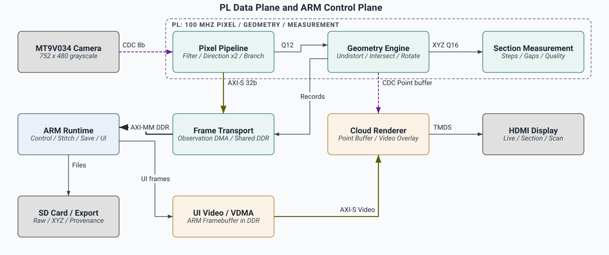
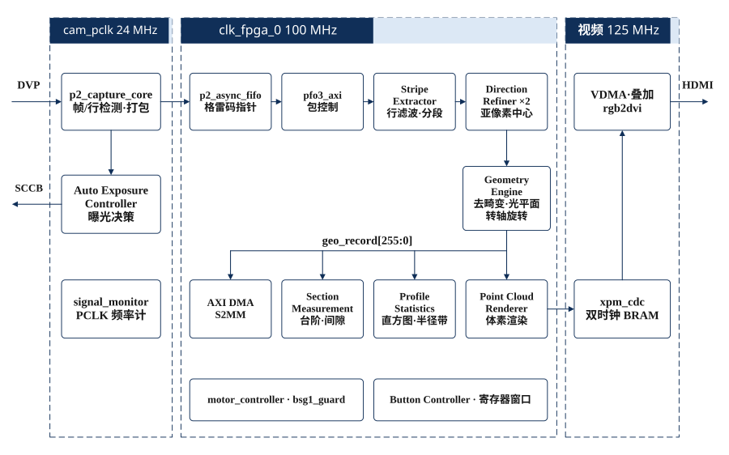

# 系统架构

系统基于PYNQ-Z2，将线激光图像转换为带帧身份的二维观测、三维点及截面测量结果。PL承担确定性的图像与几何运算；PS负责运行编排、扫描级拼接、界面、保存和结果管理。

## 主数据通路

相机输入和DDR回放共用PL算法入口。完整通路如下：

[可编辑架构规格](media/system_architecture.json)

| 功能模块 | 职责 | 实现入口 |
|---|---|---|
| Camera Capture / CDC FIFO | 接收8位灰度、PCLK、FV和LV，建立帧边界并跨到系统域 | [Capture Core](../src/fpga/rtl/p2_capture_core.sv) |
| Shared Window Filter | 复用窗口，生成滤波与导数特征 | [Window Filter](../src/fpga/rtl/r41_window_filter.sv) |
| Direction Refinement | 方向与亚像素中心精化，生产配置默认两路 | [Direction Core](../src/fpga/rtl/r35_direction.sv) |
| Stripe Extraction / Branch Linking | 候选管理、分支关联、质量及两模式判定 | [Frontend](../src/fpga/rtl/r35_frontend.sv) |
| Fixed-point Geometry | 归一化、逆畸变、激光平面求交及旋转变换 | [Geometry Engine](../src/fpga/rtl/r35_geometry.sv) |
| Point Cache | 保存待序列化的几何记录 | [Point Cache](../src/fpga/rtl/r35_point_cache.sv) |
| Measurement Statistics | 距离、范围、分层半径等统计 | [Measurement Statistics](../src/fpga/rtl/r41_measure.sv) |
| Section Measurement | 截面分段、台阶、间隙及残差 | [Section Solver](../src/fpga/rtl/section_measure.sv) |
| Cloud Renderer | 点云缓存、投影及视频叠加 | [Cloud View](../src/fpga/rtl/r40_cloud_view.sv) |
| Transport / Control | AXI-Lite、输入选择、记录封装及DMA流 | [AXI Frontend](../src/fpga/rtl/r35_axi.sv) |

测量统计、截面求解和显示模块观察同一几何输出，并使用包的提交/丢弃边界，避免把失败包点集发布为完成结果。

## PL逻辑与时钟域

[可编辑Visio源图](media/pl_logic.vsdx)

## PL与PS边界

正常PL路径中的像素提取、图像分支关联和定点几何均在硬件执行。ARM的[几何接收适配器](../src/ps/r33/geometry_pl_r35.py)核对参数绑定后，选择并解包PL输出的XYZ，不重新执行射线、畸变和旋转运算。[协议解码器](../src/ps/r33/protocol_r35.py)核对几何集合、模式位、状态和计数，并记录实际几何后端。

ARM仍负责设备管理、参数配置、扫描角度与任务状态、累积点云、页面组织、保存和导出。浮点几何参考保留用于测试和显式对照，不与正常硬件路径混算。

| PS模块 | 实现 |
|---|---|
| 实时相机与三页运行入口 | [Live Runtime](../src/ps/r33/live.py) |
| 真实PL回放 | [Replay Runtime](../src/ps/r33/replay.py) |
| HDMI与页面 | [Display](../src/ps/r33/display.py)、[Page State](../src/ps/r33/page_state.py) |
| 按键与页面选择 | [Buttons](../src/ps/r33/buttons.py) |
| PL截面结果适配 | [PL Section](../src/ps/r33/pl_section.py) |
| 完整帧日志 | [Storage](../src/ps/r33/storage.py) |

## 定点与身份合同

- 二维中心采用带12位二进制小数的Q12编码，几何输出采用Q16毫米坐标。
- 几何内部使用Q30，camera和axis坐标输出为有符号Q16。
- Q30转Q16采用最近偶数舍入，并显式检查范围和溢出。
- 几何参数通过epoch和SHA绑定。ARM在读取XYZ前核对标定来源、角度与几何配置。
- measurement和preview共用中间计算，保留独立接受集合和结果。preview点不自动进入正式尺寸。

几何核为共享DSP的有界状态机，一次只有一个在途点；Brown逆畸变使用五次有界迭代。方向通道数量不能等同于几何核并行数量，也不表示几何每拍输出一个点。

旧的全帧各阶矩模块已从生产配置移除，其kind 4/5记录允许为空，footer相应计数为零。当前仍有实际消费者的测量统计由Measurement Statistics和Section Measurement承担。

## DDR与时钟分工

| 通路/时钟域 | 用途 |
|---|---|
| 相机PCLK | 外部输入域，经跨域结构送入系统域 |
| 系统100MHz | 像素、方向、几何、测量和AXI控制 |
| 视频125MHz | 视频搬运、合成与HDMI输出 |
| PS GP0 | AXI-Lite寄存器控制 |
| PS HP0 | Raw DMA |
| PS HP1 | HDMI VDMA |
| PS HP2 | PFO3 MM2S、S2MM及SG访问 |
| PS HP3 | 当前BD未启用 |

连接依据为[Block Design重建脚本](../src/fpga/bd/block_design_r40.tcl)。当前接口表见[硬件说明](hardware.md)。

## 保存与界面

完整帧事务包括Raw、primary、观测、measurement XYZ、preview XYZ、回执及元数据。[存储实现](../src/ps/r33/storage.py)在事务flush和fsync后发布持久化确认；入队、处理完成和持久化完成分别计数。

三页分别展示实时观测、截面测量和整圈扫描。BTN1–3直接选页；BTN0产生扫描开始/停止请求，由运行状态与运动准入共同决定是否执行。

## 构建配置

[发布构建入口](../build/reproduce.py)默认双方向通道，四个dispatch/banking开关为0。构建参数与通道路数由Tcl脚本统一设置。

先按[复现说明](build_and_deploy.md)恢复原始文件名和目录，再执行完整构建。主Tcl入口为[Full Build](../src/fpga/scripts/build_final.tcl)；依赖缺失route.dcp的历史seedretry辅助脚本不是推荐入口。
