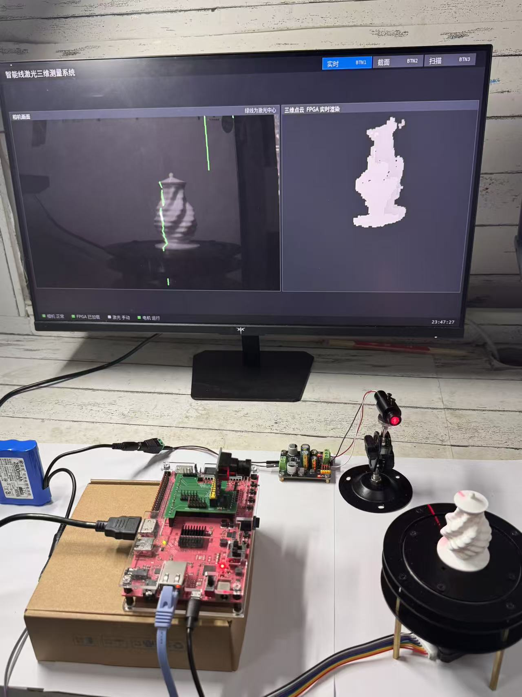

# Intelligent Line-Laser 3D Measurement System

[中文首页](../readme.md)

A compact PYNQ-Z2 system for non-contact profiles and rotary 3D scanning. An MT9V034 camera captures a line-laser stripe. The programmable logic performs shared-window filtering, directional centre refinement, branch processing, fixed-point geometry, measurement statistics and cloud rendering. The ARM runtime coordinates scanning, validates records, manages the user interface, stitches scans and saves data.



## Hardware

PYNQ-Z2 / XC7Z020, 752×480 grayscale input, 1280×720 HDMI, 100MHz system domain and 125MHz video domain. The default build uses two direction lanes. The geometry engine reuses DSP arithmetic in a bounded state machine.

Archived implementation: 39,111 LUTs (73.52%), 50,902 FFs (47.84%), 78.93% BRAM, 134 DSPs (60.91%), WNS +0.230ns, WHS +0.011ns and zero Critical CDC findings in the saved report. These are archived implementation results, not measurements newly performed for this repository update.

## Start without hardware

```sh
git clone https://github.com/ForrestKang/pynq-structured-light.git
cd pynq-structured-light
python -B tools/check_repository.py
python -B skill/verify_bundle.py .
python -B skill/test_pynq_release_check.py
python -B build/restore_sources.py --output ../scan3d_work
```

The output directory must not exist. Source restoration preserves original file names and bytes. Install software dependencies from `sim/requirements_pc.txt`; read [Getting started](getting_started.md) before running software or RTL tests. Rebuild using `build/reproduce.py` with Vivado2025.2 and XC7Z020 support.

## Status

The inherited ARM regression has 61 passes, seven failures and one skip out of69 tests. Firmware files match their saved manifest, but two runtime guards do not. The repository is a documented handoff candidate; do not bypass these guards to call it a validated deployment. Repository CI checks packaging, links, source restoration and utility tests only.

See [architecture](architecture.md), [interfaces](hardware.md), [validation](validation.md), [known issues](known_issues.md), [report](../report/design_report.pdf) and [AI collaboration](../report/ai_collaboration_records.md).

BTN1 selects live capture, BTN2 the section page, BTN3 the scanning page. BTN0 requests scan start/stop, subject to the runtime and motion checks. Calibration, physical wiring and motion authority are device-specific.

Original project code, tests and documentation use the existing [MIT license](../license.md). Vendor IP, reference code and fonts retain their own licenses; see [third-party notices](../report/third_party_notices.md).
