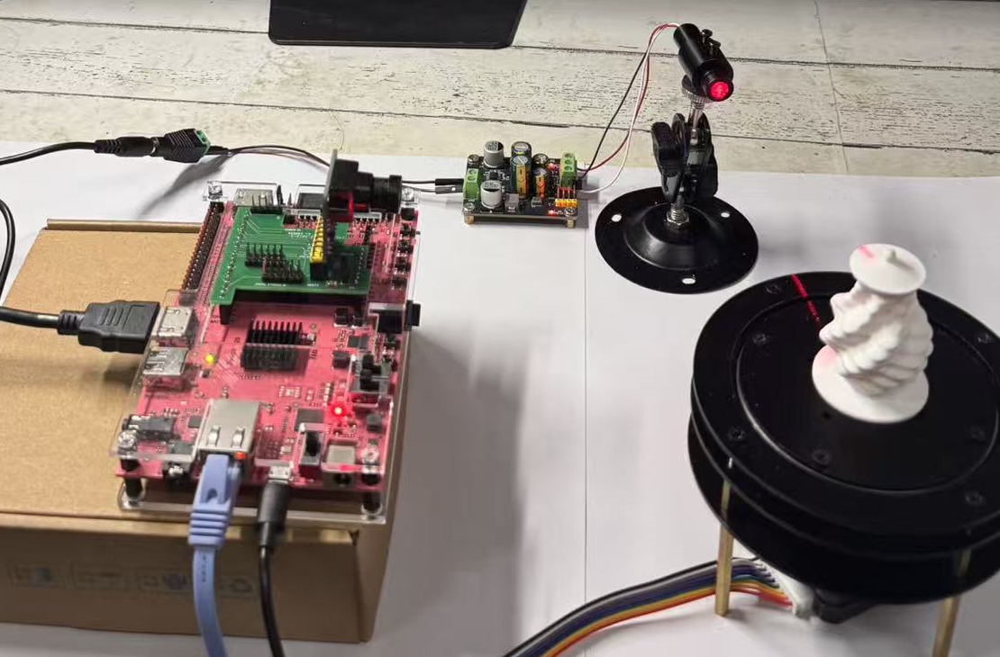
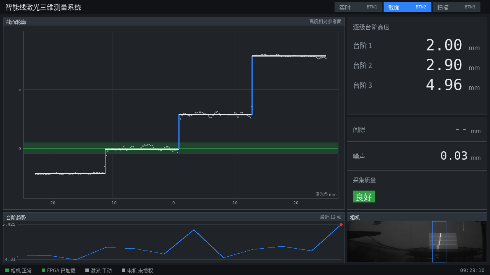
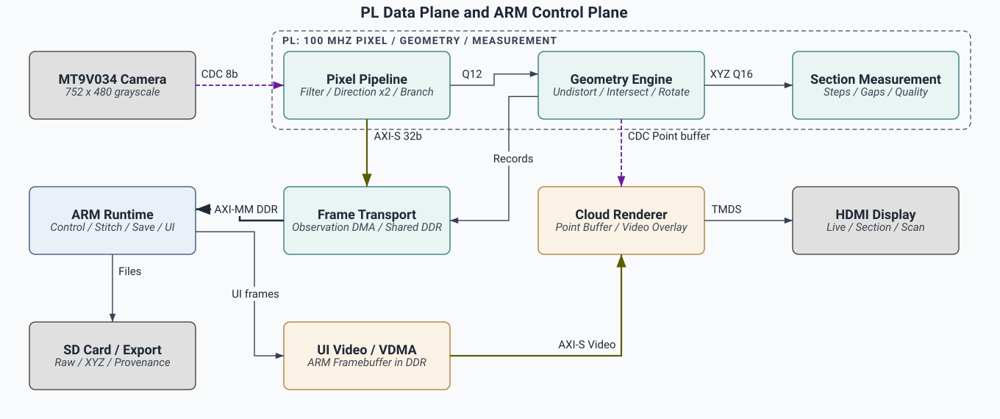

# 智能线激光三维测量系统

**Intelligent Line-Laser 3D Measurement System**

基于 **PYNQ-Z2** 的小型线激光三维测量装置：相机采集激光条纹，FPGA完成亚像素提取、定点几何和截面统计，屏幕显示当前截面与逐步形成的点云，ARM负责扫描编排、界面、拼接与完整数据保存。

[](readme.md) [](docs/readme_en.md)

[快速开始](docs/getting_started.md) · [系统架构](docs/architecture.md) · [硬件接口](docs/hardware.md) · [构建与部署](docs/build_and_deploy.md) · [验证结果](docs/validation.md)



## 作品做什么

面向小型零件、台阶和旋转外形的非接触截面检测与三维展示。单块开发板接入灰度相机、线激光、转台和HDMI显示器，提供实时观测、截面测量和整圈扫描三种界面。

- **完整PL算术通路**：共享窗口、方向精化、条纹与分支处理、Brown逆畸变、光平面求交、转轴变换、测量与点云显示。
- **测量与预览分开**：分别保留接受位、拒绝原因和XYZ，预览点不混入正式测量集合。
- **完整记录**：保存原图、硬件输出、观测、三维点、参数来源与错误状态，支持读回核查。
- **按键操作**：BTN1实时页、BTN2截面页、BTN3扫描页；BTN0在运行准入满足时发起开始/停止扫描请求。
- **可交接工程**：提供RTL、XDC、BD重建脚本、ARM源码、原生C、固件、测试、报告和恢复/构建入口。

## 三种界面

下面是程序直接生成的界面图，展示实时观测、截面测量和扫描信息。

### 实时观测 · BTN1

相机条纹、当前点云及处理状态在同一页显示。


### 截面测量 · BTN2

显示截面轮廓、逐级台阶高度、噪声与质量趋势。



### 整圈扫描 · BTN3

显示累积点云、角度进度、分层直径和扫描记录。


## 处理分工



| 处理侧 | 主要职责 |
|---|---|
| PL | 像素提取、分支与质量、定点几何、截面测量、点云叠加 |
| ARM | 参数与扫描编排、数据校验、扫描级拼接、页面组织、完整保存 |

正常几何坐标由PL产生，ARM解包时核对参数与帧身份。方向核默认两路；几何核复用DSP并采用有界状态机，并非每拍输出一个三维点。详细模块、位宽和时钟域见[系统架构](docs/architecture.md)。

## 平台与实现结果

| 项目 | 配置 / 已保存结果 |
|---|---|
| 开发板 / 器件 | PYNQ-Z2 / XC7Z020 |
| 相机输入 / 显示 | 752×480、8位灰度 / 1280×720 HDMI |
| 实现工具 | Vivado 2025.2 |
| 系统 / 视频域 | 100 / 125 MHz |
| LUT / FF | 39,111（73.52%）/ 50,902（47.84%）|
| BRAM / DSP | 78.93% / 134个（60.91%）|
| 布线后时序 | WNS +0.230 ns，WHS +0.011 ns |
| CDC Critical | 保存报告为0 |

数据来自[归档实现报告复核](report/source_report_gate.json)，不是本次重新构建或新的整链测速。PL图像速度、完整扫描速度、HDMI更新与保存速度分别统计，见[结果口径](docs/results.md)。

## 先在电脑运行

Python 3.10及以上；先检查包和工具，不需要板卡或Vivado：

```powershell
git clone https://github.com/ForrestKang/pynq-structured-light.git
cd pynq-structured-light
python -B tools/check_repository.py
python -B skill/verify_bundle.py .
python -B skill/test_pynq_release_check.py
```

接着恢复原工程大小写和目录：

```powershell
python -B build/restore_sources.py --output ../scan3d_work
python -m pip install -r sim/requirements_pc.txt
python -B sim/run_release_tests.py --work ../scan3d_work --output ../scan3d_pc_results --cc gcc
```

完整软件回归需要本机C编译器；依赖包括OpenCV，用于真实图像和显示测试。构建出的主机动态库仅用于电脑验证，不能复制到ARM运行。输出目录必须尚不存在。截面195包与整板RTL矩阵的复现命令见[快速开始](docs/getting_started.md)。

## 当前交付状态

| 范围 | 状态 |
|---|---|
| 源码、接口、恢复与构建入口 | 已归集，可从新目录恢复 |
| 包完整性与离线发布检查工具 | 已验证；CI只检查这一范围 |
| 软件修复 | 修复旧Mock协议字段与故障注入检查；默认质量读取PL摘要，Raw饱和统计改为显式诊断 |
| 完整软件回归 | 已提供全部runtime测试入口；最终实跑结果见[验证汇总](report/release_validation.json) |
| 固件 / runtime配套 | 11项离线配套测试、27个归档primary子例通过；新软件绑定独立记录，旧清单保留 |
| 截面RTL | 182帧历史原图和13个合成输入，共195包逐位对照通过 |
| 整板RTL矩阵 / 实现 / 板端 | 矩阵结果见验证汇总；本轮没有重新布局布线或上板 |

本轮只在电脑修复与验证。45份非生成硬件构建输入、bit/HWH及旧源码冻结记录保持不变；当前软件组合见[运行时验证记录](board/firmware/runtime_validation.json)。已知问题及现场复验范围见[known_issues.md](docs/known_issues.md)，旧清单和失败记录继续保留。

## 仓库导航

| 目录 | 内容 |
|---|---|
| [docs/](docs/readme.md) | 新读者入口、架构、硬件、部署、结果和排障 |
| [src/fpga/](src/fpga) | RTL、XDC、BD、模型、原构建脚本与必要IP |
| [src/ps/](src/ps) | ARM运行时、原生库与C源码、字体和测试 |
| [build/](build) | 原文件名恢复、一键构建和既有实现报告 |
| [sim/](sim/readme.md) | 离线回归、RTL入口、测试输入与结果 |
| [board/](board/readme.md) | bit/HWH、冻结manifest、板端证据、启动参考 |
| [data/](data) | 标定、输入与参考数据 |
| [skill/](skill/readme.md) | 可复用包校验、固件/runtime绑定检查 |
| [report/](report/readme.md) | [设计报告PDF](report/design_report.pdf)、[Word](report/design_report.docx)、AI协作与提交说明 |
| [tools/](tools) | 仓库链接、语法及材料自检 |

提交材料总览见[submission.md](docs/submission.md)；代码修改规范见[contributing.md](contributing.md)。大体积原始录像和整卡镜像不放入Git。

## 许可证

自有新代码、测试和文档沿用仓库[MIT许可证](license.md)。厂商IP、外部参考代码及字体保留原许可，详见[第三方说明](report/third_party_notices.md)。
