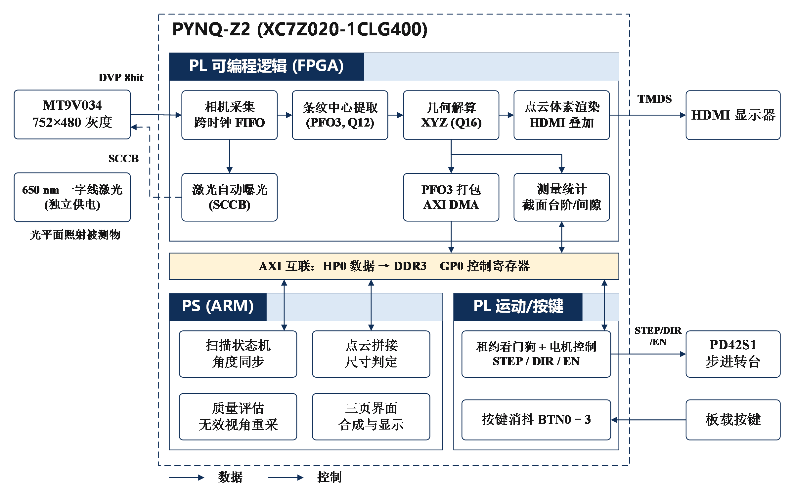

# 智能线激光三维测量系统

**Intelligent Line-Laser 3D Measurement System**

基于 **PYNQ-Z2** 的小型线激光三维测量装置：相机采集激光条纹，FPGA完成亚像素提取、定点几何和截面统计，屏幕显示当前截面与逐步形成的点云，ARM负责扫描编排、界面、拼接与完整数据保存。

[](readme.md) [](report/readme_en.md)

[电脑测试](#先在电脑运行) · [构建与板端启动](#构建与板端启动) · [技术报告](report/design_report.pdf)

## 工程包怎么使用

本RAR是完整工程包，包含设计源码、仿真输入与结果、综合实现报告、板端程序与实测数据、技能包和设计报告。将RAR解压到一个新建文件夹，解压后直接看到本说明、`src/`、`sim/`和`build/`等目录，在这个位置打开终端。使用RAR的读者不需要再下载Git仓库。

| 你要做什么 | 先看哪里 |
|---|---|
| 了解作品原理与实测结果 | [技术报告](report/design_report.pdf) |
| 在电脑上复现程序和验证结果 | 本页[先在电脑运行](#先在电脑运行)，依次完成环境准备、工程恢复和测试 |
| 重新运行RTL仿真 | [仿真说明](sim/readme.md)，含空帧、完整19例及195包截面测试命令 |
| 用Vivado重新生成固件 | [构建说明](build/readme.md) |
| 在PYNQ上运行相机和界面 | [板端说明](board/readme.md)，使用当前装置的标定与配置 |
| 在其他题目里复用技能 | [技能说明](skill/readme.md) |

`src/`是按提交规范归类的源码。`build/restore_sources.py`会在新目录中恢复编译和测试需要的`fpga/`、`runtime/`、`firmware/`及相关数据布局；后续构建和测试使用这个恢复目录。原RAR解压目录保持不动。


## 作品做什么

面向小型零件、台阶和旋转外形的非接触截面检测与三维展示。单块开发板接入灰度相机、线激光、转台和HDMI显示器，提供实时观测、截面测量和整圈扫描三种界面。

- **完整PL算术通路**：共享窗口、方向精化、条纹与分支处理、Brown逆畸变、光平面求交、转轴变换、测量与点云显示。
- **测量与预览分开**：分别保留接受位、拒绝原因和XYZ，预览点不混入正式测量集合。
- **完整记录**：保存原图、硬件输出、观测、三维点、参数来源与错误状态，支持读回核查。
- **按键操作**：BTN1实时页、BTN2截面页、BTN3扫描页；BTN0在运行准入满足时发起开始/停止扫描请求。
- **可交接工程**：提供RTL、XDC、BD重建脚本、ARM源码、原生C、固件、测试、报告和恢复/构建入口。

## 三种界面

下面是程序直接生成的界面图，展示实时观测、截面测量和扫描信息。

### 实时观测 · BTN1

相机条纹、当前点云及处理状态在同一页显示。


### 截面测量 · BTN2

显示截面轮廓、逐级台阶高度、噪声与质量趋势。


### 整圈扫描 · BTN3

显示累积点云、角度进度、分层直径和扫描记录。


## 处理分工



| 处理侧 | 主要职责 |
|---|---|
| PL | 像素提取、分支与质量、定点几何、截面测量、点云叠加 |
| ARM | 参数与扫描编排、数据校验、扫描级拼接、页面组织、完整保存 |

正常几何坐标由PL产生，ARM解包时核对参数与帧身份。方向核默认两路；几何核复用DSP并采用有界状态机，并非每拍输出一个三维点。二维中心采用Q12，几何内部采用Q30，输出有符号Q16毫米坐标，Q30到Q16采用最近偶数舍入并检查溢出。参数通过epoch和SHA绑定，ARM核对标定、角度与帧身份后接收结果。

## 实测效果

| 项目 | 结果 |
|---|---|
| 图像处理 | FPGA随相机逐帧处理，约26.5帧/s |
| 整圈扫描 | 200个视角，约2.5分钟，约6.6万个测量点 |
| 台阶高差 | 卡尺值2、3、5 mm；截面读数2.00、2.90、4.96 mm |
| 阶梯圆柱 | 三段直径扫描值39.68、29.90、19.88 mm |
| 波纹花瓶 | 颈部卡尺值16.5 mm；扫描值16.23～16.55 mm |

阶梯圆柱参与过参数调整，其尺寸用于复核；花瓶为独立打印件对照。图像帧率、扫描时间、显示与持久化速度分别统计。标定方法、测量图像和尺寸对照见[技术报告](report/design_report.pdf)。

## 平台与实现结果

| 项目 | 配置 / 结果 |
|---|---|
| 开发板 / 器件 | PYNQ-Z2 / XC7Z020 |
| 相机输入 / 显示 | 752×480、8位灰度 / 1280×720 HDMI |
| 实现工具 | Vivado 2025.2 |
| 系统 / 视频域 | 100 / 125 MHz |
| LUT / FF | 39,111（73.52%）/ 50,902（47.84%）|
| BRAM / DSP | 78.93% / 134个（60.91%）|
| 布线后时序 | WNS +0.230 ns，WHS +0.011 ns |
| CDC Critical | 0 |

实现结果见[资源与时序报告](report/source_report_gate.json)。系统完成像素处理、三维重建、截面测量、HDMI显示与完整数据保存，逐项验证见[验证汇总](report/release_validation.json)。以上为随包历史记录，不代表每次源码重建都已完成同样的板端验证。

## 先在电脑运行

### 第一步 准备环境

安装Python 3.10或以上，并确认终端能运行`python`。完整软件测试还需要可从命令行调用的gcc；RTL仿真需要Icarus Verilog的`iverilog`和`vvp`；重新生成固件需要Vivado 2025.2及XC7Z020器件支持。仅查看报告无需安装这些工具。

在工程包根目录执行：

```powershell
python --version
gcc --version
python -m pip install -r sim/requirements_pc.txt
```

依赖包括NumPy、Pillow、SciPy、fonttools和OpenCV。建议在独立Python环境中安装；`sim/requirements_pc.txt`列出所需依赖，运行结果会记录实际测试环境。

### 第二步 检查文件并恢复工程

```powershell
python -B sim/tools/check_repository.py
python -B build/restore_sources.py --output ../scan3d_work
```

第一条检查工程结构、文档链接和脚本语法；第二条在上一级新建`scan3d_work/`，恢复完整工作布局。成功后应能看到`scan3d_work/fpga/`、`scan3d_work/runtime/`及`scan3d_work/firmware/`。输出目录必须原先不存在；重跑时换一个新目录名，保留上次结果。

### 第三步 运行完整软件测试

仍在工程包根目录执行：

```powershell
python -B sim/run_release_tests.py --work ../scan3d_work --output ../scan3d_pc_results --cc gcc
python -B sim/test_release_pairing.py
```

第一条会先构建电脑使用的原生辅助库，再执行全部279项运行时测试；结果写入`scan3d_pc_results/result.json`，详细日志在同目录`console.log`。第二条核对软件、接口和配套固件。检查结果中的通过、失败和跳过项，不只看程序是否退出。电脑生成的动态库用于电脑测试，板端使用ARM架构的库。

### 第四步 运行RTL仿真

先用空帧检查仿真环境：

```powershell
python -B sim/run_rtl_integration.py --work ../scan3d_work --output ../scan3d_rtl_results --iverilog iverilog --vvp vvp --cases empty
```

截面模块使用182帧历史原图和13包合成输入，逐位核对195包。为这一组测试单独恢复一个工作目录：

```powershell
python -B build/restore_sources.py --output ../scan3d_section_work
python -B sim/run_section_rtl.py --work ../scan3d_section_work --output ../scan3d_section_results --iverilog iverilog --vvp vvp --workers 2
```

完整19例整链仿真的命令与结果位置见[仿真说明](sim/readme.md)。这些步骤均在电脑上执行，不连接板卡。

## 构建与板端启动

```powershell
python -B build/reproduce.py --work ../scan3d_build_work --output ../scan3d_build_output --vivado vivado
```

完整构建从恢复后的`fpga/scripts/build_final.tcl`开始，默认双方向通道、四个dispatch/banking开关为0，不静默升级IP。输出含日志、资源、setup/hold、脉宽、DRC、CDC报告及bit/HWH和manifest。历史seedretry脚本依赖未提供的route.dcp，请使用上述完整入口。

板端需要PYNQ镜像及对应ARM/Python/PYNQ环境。先核对板卡身份、实际接线、当前内参/光平面/转轴/转角、原生库架构、磁盘空间和回退副本，再按[板端入口](board/readme.md)部署匹配的固件与runtime。`board/boot_reference/`含本装置的启动服务、旧路径与自动演示配置，移植时先修改设备配置，不直接覆盖另一块板的`/boot`。

在恢复后并部署到板端的runtime目录查看真实入口参数，再按当前装置配置启动：

```sh
python -B -m r33.live --help
python -B -m r33.replay --help
```

`live`用于相机实时运行，`replay`用于真实PL回灌；具体固件、数据与配置参数以`--help`为准。首次静态采集与加载时断开电机12 V，再依次验证ABI、静态采集、PL回灌、HDMI、完整保存和受控运动。真实运动前确认机械固定、线缆、供电和有效标定。

BTN1、BTN2、BTN3分别直接进入实时、截面和扫描页；BTN0发出开始/停止扫描请求，由状态机及运动准入决定是否执行。按键不替代固件、标定和运动准入。

## 数据与验证记录

每帧保存Raw灰度、primary硬件流、观测、measurement XYZ、preview XYZ、回执与metadata/trace，保留帧号、epoch、参数身份、角度、错误和耗时。正常质量取自PL摘要；`--diagnostic-raw-quality`显式启用Raw饱和诊断，不改变测量接受判据。文件布局见[存储实现](src/ps/r33/storage.py)。入队、处理完成和持久化分别计数，事务flush/fsync后才发布持久化确认；取消时保留已接受、失败和未完成范围。

| 随包验证内容 | 历史结果 |
|---|---|
| 完整运行时 | 279项通过，覆盖协议、几何、界面、存储与故障处理 |
| 入口与三页界面 | 71项通过，属于完整运行时测试范围 |
| 软件固件配套 | 11项通过，核对27份数据包、接口及原生库架构 |
| 通用PYNQ Skill | DMA诊断、参考结果比对及性能分析工作流；9项独立导出测试通过 |
| 截面测量RTL | 195包与定点模型逐位一致 |
| 整链RTL | 19例全尺寸输入通过，覆盖空帧、噪声、饱和及候选溢出 |

逐项结果见[验证汇总](report/release_validation.json)及[固件配套记录](board/firmware/runtime_validation.json)。[板端历史数据](board/readme.md)包含回执与量化点云恢复件，其范围以来源清单为准，不等同于完整原始采集。

## 排障

| 现象 | 检查入口 |
|---|---|
| 恢复失败、字体或大小写不匹配 | 使用新的恢复目录，核对source_map和依赖 |
| 构建找不到工具或器件 | Vivado 2025.2、XC7Z020支持、PATH |
| 固件检查或ABI失败 | bit/HWH、manifest、驱动、实际MMIO与ARM库架构 |
| 相机ID/PCLK异常 | 供电、XDC与实际接线、复位、相机诊断寄存器 |
| HDMI黑屏或延迟 | 视频时钟、VDMA、显示缓冲与提交确认时间 |
| 内存不足或保存停顿 | 普通内存与CMA分别检查；记录分配结果、同步耗时、队列帧数/字节数和磁盘余量 |
| 点云环带、错层或台阶异常 | 光平面、转轴、实际转角、单位、参数来源及物体/参考台面/背景分离 |

定位时保留源码提交、固件/库身份、配置、完整命令、输入和原始错误日志。相机、激光或转台位置改变后复核标定。

## 仓库导航

本工程按选题指南第3.3.5节的七类目录组织。采用手写RTL与PS侧软件，未采用HLS；无需另外提供空的HLS工程。源码文件名保持小写英文；`readme.md`承担指南中`README.md`的项目入口作用，`skill/readme.md`说明各项技能的范围、用法、验证效果和失效条件。

| 目录 | 内容 |
|---|---|
| [src/](src/) | FPGA RTL、XDC、BD、ARM运行时、原生C、字体与必要IP |
| [sim/](sim/readme.md) | 离线/RTL测试、输入、结果及`sim/tools/`仓库校验工具 |
| [build/](build/) | 文件名恢复、完整构建入口及实现报告 |
| [board/](board/readme.md) | 固件、manifest、板端证据与启动参考 |
| [data/](data/) | 标定、输入与参考数据 |
| [skill/](skill/readme.md) | 通用DMA、参考结果与性能资源诊断流程 |
| [report/](report/design_report.pdf) | 技术报告、图像、验证与AI协作记录 |

[技术报告PDF](report/design_report.pdf) · [可编辑Word](report/design_report.docx) · [AI协作记录](report/ai_collaboration_records.md) · [可复用工具开发](report/skill_development.md)

资源与时钟原始报告在`build/evidence/reports/`，前端基线在`build/evidence/baseline_reports/`；报告中的资源前后对比标明了截面测量硬件化这一功能变化。仿真输入与参考结果由`sim/support/`及`source_map.json`绑定；板端回执和点云对比在`board/evidence/`与`board/historical_outputs/`。从下载、恢复、软件验证、RTL验证到完整构建的顺序见上面的命令；各步骤使用新的工作和输出目录。

## 许可证

自有新代码、测试和文档沿用仓库[MIT许可证](license.md)。厂商IP、外部参考代码及字体保留原许可，详见[第三方说明](report/third_party_notices.md)。

[中英文海报PPTX](report/images/poster.pptx)
