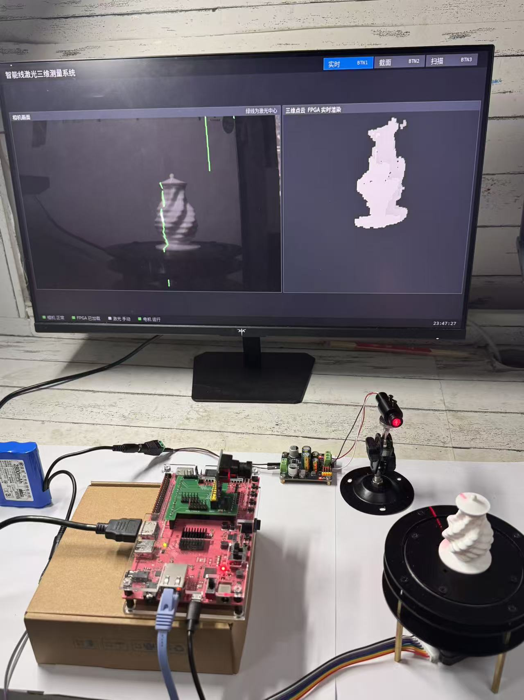
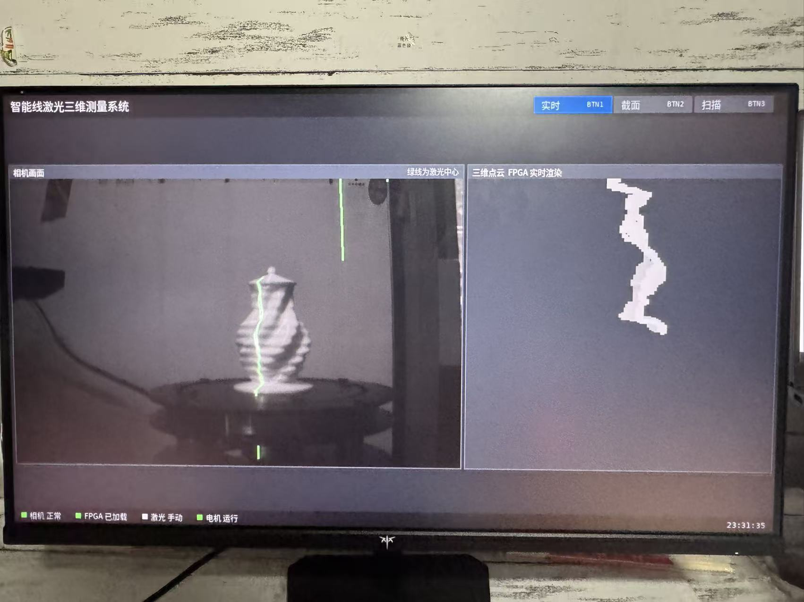
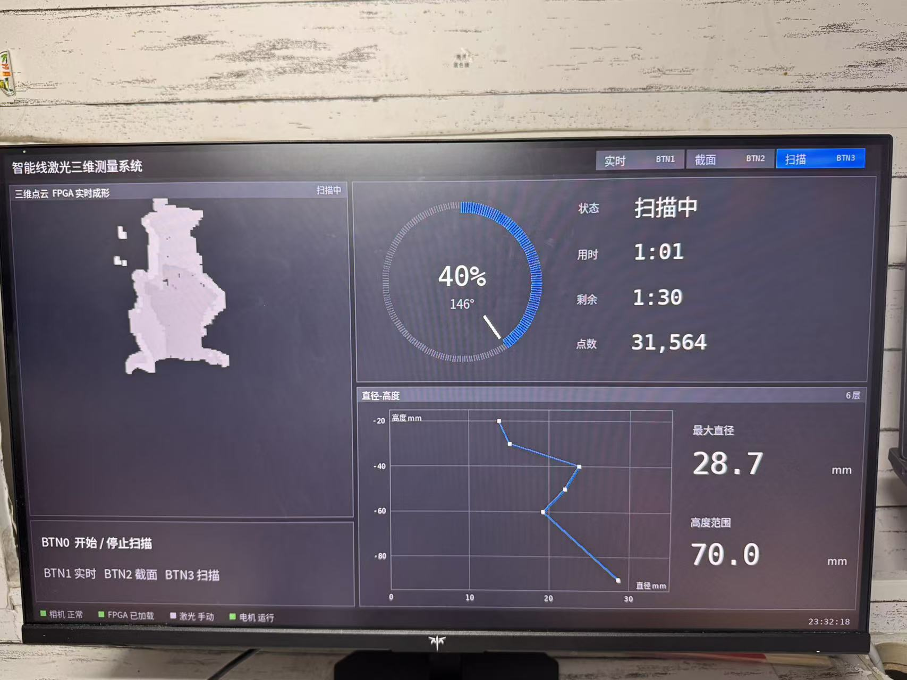
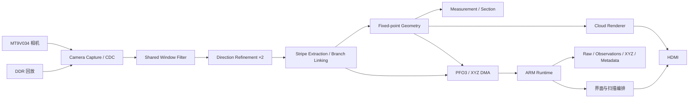

# 智能线激光三维测量系统

**Intelligent Line-Laser 3D Measurement System**

基于 **PYNQ-Z2** 的小型线激光三维测量装置：相机采集激光条纹，FPGA完成亚像素提取、定点几何和截面统计，屏幕显示当前截面与逐步形成的点云，ARM负责扫描编排、界面、拼接与完整数据保存。

[快速开始](docs/getting_started.md) · [系统架构](docs/architecture.md) · [硬件接口](docs/hardware.md) · [构建与部署](docs/build_and_deploy.md) · [验证结果](docs/validation.md) · [English](docs/readme_en.md)



## 作品做什么

面向小型零件、台阶和旋转外形的非接触截面检测与三维展示。单块开发板接入灰度相机、线激光、转台和HDMI显示器，提供实时观测、截面测量和整圈扫描三种界面。

- **完整PL算术通路**：共享窗口、方向精化、条纹与分支处理、Brown逆畸变、光平面求交、转轴变换、测量与点云显示。
- **测量与预览分开**：分别保留接受位、拒绝原因和XYZ，预览点不混入正式测量集合。
- **完整记录**：保存原图、硬件输出、观测、三维点、参数来源与错误状态，支持读回核查。
- **按键操作**：BTN1实时页、BTN2截面页、BTN3扫描页；BTN0在运行准入满足时发起开始/停止扫描请求。
- **可交接工程**：提供RTL、XDC、BD重建脚本、ARM源码、原生C、固件、测试、报告和恢复/构建入口。

## 三种界面

| 实时观测 | 截面测量 | 整圈扫描 |
|---|---|---|
|  |  |  |
| 相机条纹与当前点云 | 截面曲线、台阶与质量 | 扫描进度、累积点云 |

以上为既有界面与现场素材。尺寸结果和验证条件统一见[验证文档](docs/validation.md)，界面截图不代替测试记录。

## 处理分工



正常几何坐标由PL产生，ARM解包时核对参数与帧身份。方向核默认两路；几何核复用DSP并采用有界状态机，并非每拍输出一个三维点。详细模块、位宽和时钟域见[系统架构](docs/architecture.md)。

## 平台与实现结果

| 项目 | 配置 / 已保存结果 |
|---|---|
| 开发板 / 器件 | PYNQ-Z2 / XC7Z020 |
| 相机输入 / 显示 | 752×480、8位灰度 / 1280×720 HDMI |
| 实现工具 | Vivado 2025.2 |
| 系统 / 视频域 | 100 / 125 MHz |
| LUT / FF | 39,111（73.52%）/ 50,902（47.84%）|
| BRAM / DSP | 78.93% / 134个（60.91%）|
| 布线后时序 | WNS +0.230 ns，WHS +0.011 ns |
| CDC Critical | 保存报告为0 |

数据来自[归档实现报告复核](report/source_report_gate.json)，不是本次重新构建或新的整链测速。PL图像速度、完整扫描速度、HDMI更新与保存速度分别统计，见[结果口径](docs/results.md)。

## 先在电脑运行

Python 3.10及以上；先检查包和工具，不需要板卡或Vivado：

```powershell
git clone https://github.com/ForrestKang/pynq-structured-light.git
cd pynq-structured-light
python -B tools/check_repository.py
python -B skill/verify_bundle.py .
python -B skill/test_pynq_release_check.py
```

接着恢复原工程大小写和目录：

```powershell
python -B build/restore_sources.py --output ../scan3d_work
python -m pip install -r sim/requirements_pc.txt
python -B sim/run_runtime_tests.py --work ../scan3d_work --output ../scan3d_pc_results
```

输出目录必须尚不存在。完整命令、RTL依赖与预期结果见[快速开始](docs/getting_started.md)。

## 当前交付状态

| 范围 | 状态 |
|---|---|
| 源码、接口、恢复与构建入口 | 已归集，可从新目录恢复 |
| 包完整性与离线发布检查工具 | 已验证；CI只检查这一范围 |
| 继承的ARM业务回归 | 69项中61通过、7失败、1跳过 |
| 固件 / runtime配套 | bit/HWH匹配，2项runtime guard仍不匹配 |
| RTL / 整板 / 板端 | 原始证据保留；本次文档整理未重新运行 |

**这是带完整证据与已知问题的交接候选，不是无条件可直接上板的发布版。** 已知问题、影响与复验步骤见[known_issues.md](docs/known_issues.md)。原清单、失败记录和历史分支均保留。

## 仓库导航

| 目录 | 内容 |
|---|---|
| [docs/](docs/readme.md) | 新读者入口、架构、硬件、部署、结果和排障 |
| [src/fpga/](src/fpga) | RTL、XDC、BD、模型、原构建脚本与必要IP |
| [src/ps/](src/ps) | ARM运行时、原生库与C源码、字体和测试 |
| [build/](build) | 原文件名恢复、一键构建和既有实现报告 |
| [sim/](sim/readme.md) | 离线回归、RTL入口、测试输入与结果 |
| [board/](board/readme.md) | bit/HWH、冻结manifest、板端证据、启动参考 |
| [data/](data) | 标定、输入与参考数据 |
| [skill/](skill/readme.md) | 可复用包校验、固件/runtime绑定检查 |
| [report/](report/readme.md) | [设计报告PDF](report/design_report.pdf)、[Word](report/design_report.docx)、AI协作与提交说明 |
| [tools/](tools) | 仓库链接、语法及材料自检 |

提交材料总览见[submission.md](docs/submission.md)；代码修改规范见[contributing.md](contributing.md)。大体积原始录像和整卡镜像不放入Git。

## 许可证

自有新代码、测试和文档沿用仓库[MIT许可证](license.md)。厂商IP、外部参考代码及字体保留原许可，详见[第三方说明](report/third_party_notices.md)。
