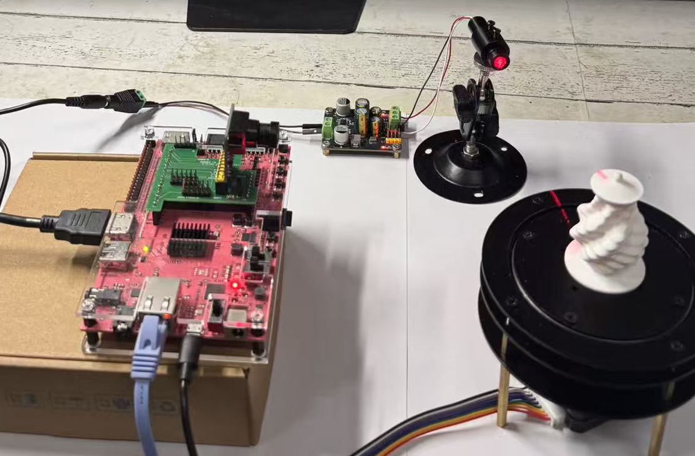
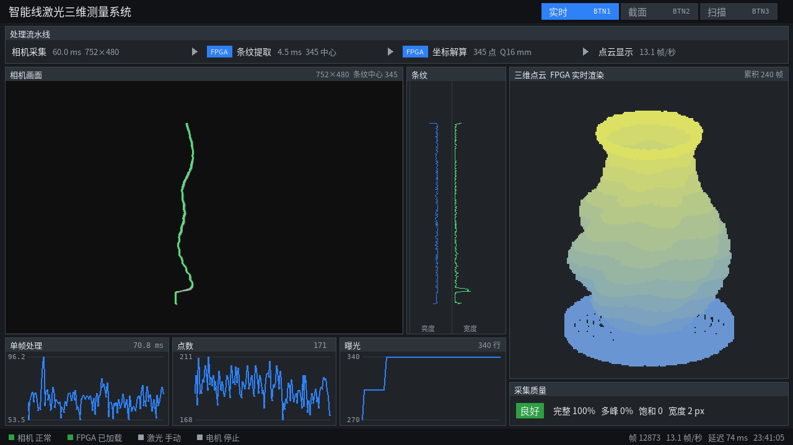
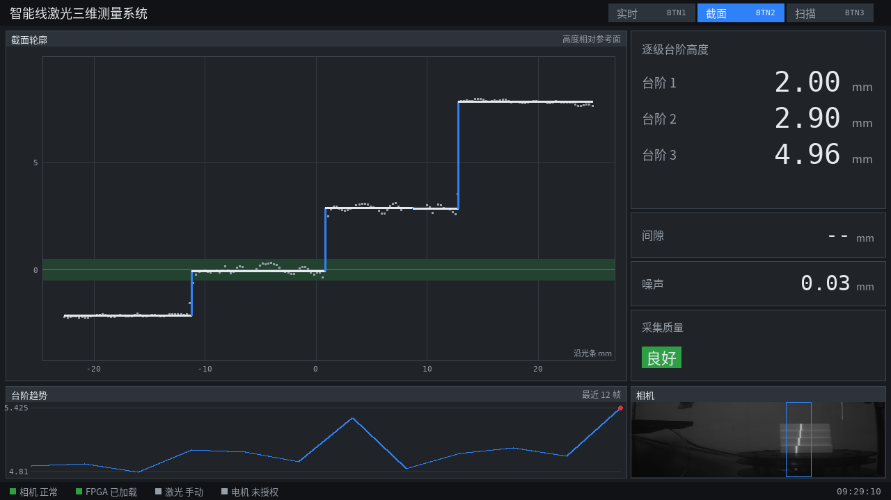
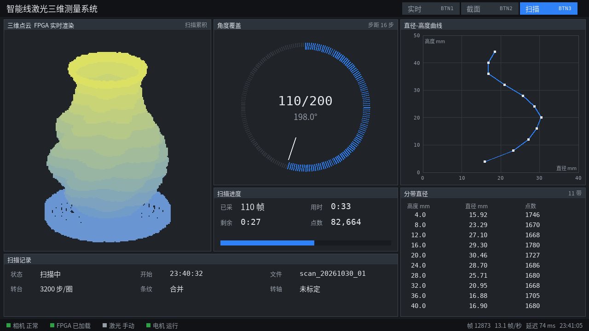
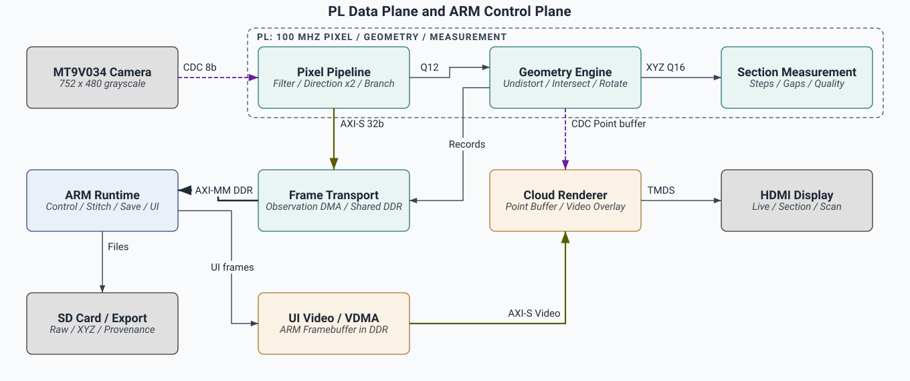

# Intelligent Line-Laser 3D Measurement System

**A compact PYNQ-Z2 instrument for non-contact profile measurement and rotary 3D scanning.**

[](../readme.md) [](readme_en.md)

[PC tests](#start-on-a-pc) · [Wiring](#wiring-and-interfaces) · [Build and board-startup](#build-and-board-startup) · [Technical report](design_report.pdf)



## What the system does

An MT9V034 camera observes a line laser on the object. The FPGA extracts the stripe centre, reconstructs 3D coordinates and computes section measurements. The display shows the current profile and the point cloud as the scan grows. The ARM runtime coordinates acquisition and rotation, manages the interface, stitches scans and saves complete records.

The system targets small parts, stepped surfaces and rotary shapes. It combines the camera, laser, turntable and HDMI display around one PYNQ-Z2 board.

- **An integrated PL processing path.** Shared-window filtering, directional centre refinement, stripe extraction, branch linking, Brown-model inverse distortion, laser-plane intersection and axis transformation run in programmable logic.
- **Hardware measurement and rendering.** The Measurement Statistics, Section Measurement and Cloud Renderer modules consume the reconstructed points.
- **Separate measurement and preview results.** Each set retains its acceptance flags, rejection reasons and XYZ records. Preview points do not enter the formal measurement set automatically.
- **Traceable data.** Raw images, hardware streams, observations, 3D points, parameter identity and error states remain available for readback and diagnosis.
- **A complete engineering handoff.** This repository includes RTL, constraints, Block Design reconstruction, ARM and native C sources, firmware, tests, reports and restoration/build entry points.

## Three operating pages

These are interface images generated directly by the page renderer from archived data.

### Live view · BTN1

Camera stripe, point cloud, processing state and quality in one view.



### Section measurement · BTN2

Section profile, individual step heights, noise and quality trends.



### Rotary scan · BTN3

Accumulated cloud, angular progress, diameter profile and scan records.



## Hardware/software partition



| Programmable logic | ARM processing system |
|---|---|
| Camera Capture and CDC FIFO | Device ownership and configuration |
| Shared Window Filter and Direction Refinement | Frame/parameter identity validation and record decoding |
| Stripe Extraction and Branch Linking | Scan control and angle coordination |
| Fixed-point Geometry and Point Cache | Scan-level stitching and cloud management |
| Measurement Statistics and Section Measurement | Interface composition, storage and export |
| Cloud Renderer and video overlay | Quality decisions and result management |

The normal path receives XYZ from the PL geometry engine. ARM validates and decodes these records instead of repeating the ray, distortion and rotation calculations. The default build uses **two direction lanes**. The geometry engine shares DSP arithmetic through a bounded state machine, with one point in flight at a time.

Image centres use Q12 encoding; geometry uses Q30 internally and emits signed Q16 coordinates.  Q30-to-Q16 conversion uses round-to-nearest-even with overflow checks. Geometry parameters are bound by epoch and SHA; ARM checks calibration, angle and frame identity before accepting XYZ.

## Measured results

| Item | Result |
|---|---|
| Image processing | Frame-by-frame FPGA processing at approximately 26.5 fps |
| Full rotary scan | 200 views in approximately 2.5 minutes, producing about 66,000 measurement points |
| Step heights | Caliper: 2, 3 and 5 mm; section readings: 2.00, 2.90 and 4.96 mm |
| Stepped cylinder | Reconstructed diameters: 39.68, 29.90 and 19.88 mm |
| Rippled vase | Neck caliper reading: 16.5 mm; scan readings: 16.23–16.55 mm |

The stepped cylinder was used during parameter adjustment, so its dimensions serve as a recheck; the vase is a separate printed comparison object. Frame rate, scan duration, display updates and persistence are separate measurements. Calibration and dimensional comparisons are in the [technical report](design_report.pdf).

## Platform and implementation

| Item | Configuration / result |
|---|---|
| Board / FPGA | PYNQ-Z2 / XC7Z020 |
| Camera input | 752 × 480, 8-bit grayscale |
| User interface | 1280 × 720 HDMI |
| Implementation tool | Vivado 2025.2 |
| System / video domain | 100 / 125 MHz |
| LUTs | 39,111 · 73.52% |
| Flip-flops | 50,902 · 47.84% |
| Block RAM | 78.93% |
| DSP slices | 134 · 60.91% |
| Post-route timing | WNS +0.230 ns · WHS +0.011 ns |
| Critical CDC findings | 0 |

The resource and timing figures are recorded in the [implementation report](source_report_gate.json). These are archived results for the supplied firmware; rebuilding the sources does not itself repeat board or dimensional validation. See the [validation summary](release_validation.json).

## Start on a PC

Run from the repository root. Python 3.10+ is sufficient for package checks. Runtime tests also need a host C compiler and NumPy, Pillow, SciPy, fonttools and OpenCV from `sim/requirements_pc.txt`. RTL tests use Icarus Verilog (`iverilog`, `vvp`). Full implementation requires Vivado 2025.2 with XC7Z020 device support. Record actual tool and package versions; the dependency list is not a lock file.

```sh
git clone https://github.com/ForrestKang/pynq-structured-light.git
cd pynq-structured-light
python -B sim/tools/check_repository.py
python -B skill/verify_bundle.py .
python -B skill/test_pynq_release_check.py
python -B build/restore_sources.py --output ../scan3d_work
python -m pip install -r sim/requirements_pc.txt
python -B sim/run_release_tests.py --work ../scan3d_work --output ../scan3d_pc_results --cc gcc
python -B sim/test_release_pairing.py
```

Restoration uses `source_map.json` to recover original filenames, case and layout, including `fpga/`, `runtime/`, `firmware/` and adjacent test inputs. Work and output directories must be new. Host-built libraries are PC test helpers; the board needs libraries compiled for its ARM architecture.

```sh
python -B sim/run_rtl_integration.py --work ../scan3d_work --output ../scan3d_rtl_results --iverilog iverilog --vvp vvp --cases empty
python -B sim/run_section_rtl.py --work ../scan3d_work --output ../scan3d_section_results --iverilog iverilog --vvp vvp --workers 2
```

The section test compares 195 packets from 182 archived frames and 13 synthetic inputs against the fixed-point model. Integration defaults to one empty-frame case; see [simulation instructions](../sim/readme.md) for all 19 cases. Use fresh restored work and output directories for another RTL run that creates derived scripts. These commands do not connect to hardware.

## Wiring and interfaces

The camera is an MT9V034 supplying 752 × 480, 8-bit grayscale. The instrument uses a 650 nm line laser, STEP/DIR/EN and guard signals for the turntable, and 1280 × 720 HDMI. This repository contains an overlay and software, not a complete SD-card system image.

The [camera XDC](../src/fpga/vendor/r31_baseline_copy/source_tree/pl/baseline/constraints/p2_pins.xdc) records the following **FPGA package pins, not camera-header positions**. Match the XDC, board schematic and camera pinout before wiring. Power and motor-driver connections depend on the actual hardware documentation; unresolved connections must be confirmed.

| Signal | FPGA package pins, LVCMOS33 |
|---|---|
| DATA[0..7] | T14, U12, U13, V13, V15, T15, R16, U17 |
| LV / FV / PCLK | V17 / V18 / U18 |
| RESET_N / STANDBY | T16 / R17 |
| SDA / SCL | P16 / P15 |
| BTN0 / BTN1 / BTN2 / BTN3 | D19 / D20 / L20 / L19 |

Other interfaces are defined in the [top-level RTL](../src/fpga/rtl/r42_board_top.sv), [constraints](../src/fpga/constraints/) and [BD Tcl](../src/fpga/bd/block_design_r40.tcl). GP0 controls registers; HP0 carries Raw DMA, HP1 HDMI VDMA and HP2 processing-result DMA. HP3 is unused. The system domain is 100 MHz, video is 125 MHz, and camera PCLK crosses through CDC logic.

The frontend base is `0x40000000`, with magic `0x57334650`, ABI `0x00035000` and feature `31`. Window `0x300` commits geometry parameters and binds epoch/SHA; `0x500` is measurement statistics, `0x600` buttons and `0x700` section measurement. Consult the [AXI RTL](../src/fpga/rtl/r35_axi.sv) and [drivers](../src/ps/r33/) for register semantics. Read the actual ABI after loading. Parameter changes revoke prior admission until a valid commit completes.

## Build and board startup

```sh
python -B build/reproduce.py --work ../scan3d_build_work --output ../scan3d_build_output --vivado vivado
python -B skill/pynq_release_check.py --manifest board/firmware/manifest.json --runtime-root src/ps
```

The build restores sources and invokes `fpga/scripts/build_final.tcl`, using two direction lanes and four dispatch/banking switches set to zero. It does not silently upgrade IP. Outputs include logs, resource, setup/hold, pulse-width, DRC and CDC reports, bit/HWH and manifest. The historical seedretry helper needs an unavailable route.dcp; use the complete entry point above.

The board needs a PYNQ image and matching ARM/Python/PYNQ environment. Check board identity, wiring, current camera/laser-plane/axis/angle calibration, native-library architecture, storage and rollback copies. Deploy matching firmware and runtime using the [board instructions](../board/readme.md). `board/boot_reference/` contains device-specific services, paths and old automatic-demo settings; adapt the configuration before using it on another board.

In the restored runtime directory deployed to the board, inspect the supported arguments before starting with the local configuration:

```sh
python -B -m r33.live --help
python -B -m r33.replay --help
```

`live` runs camera acquisition; `replay` sends data through the real PL. Firmware, input and configuration arguments are defined by `--help`. Disconnect motor 12 V for initial loading and static checks. Verify ABI, static capture, PL replay, HDMI, complete storage and then controlled motion. Confirm mechanical mounting, cables, power and calibration before rotation.

BTN1, BTN2 and BTN3 directly select live, section and scan pages. BTN0 requests scan start/stop; the state machine and motion admission determine execution. Buttons do not replace firmware, calibration or motion checks.

## Data and archived verification

Frame records retain Raw grayscale, primary hardware streams, observations, measurement XYZ, preview XYZ, receipts and metadata/trace, including frame number, epoch, parameter identity, angle, errors and timings. Normal quality comes from PL summaries. `--diagnostic-raw-quality` enables Raw saturation diagnostics without changing measurement acceptance. See the [storage implementation](../src/ps/r33/storage.py). Enqueued, processed and persisted counts remain separate; persistence is acknowledged after transaction flush/fsync. Cancellation preserves accepted, failed and unfinished ranges.

| Scope | Archived result |
|---|---|
| Runtime | 279 tests passed: protocol, geometry, interface, storage and fault handling |
| Entry point and three pages | 71 passed, a subset of the complete runtime scope |
| Firmware/runtime pairing | 11 passed, checking 27 packets, register interfaces and native-library architecture |
| Reusable PYNQ skill | 4 offline tests passed across two unrelated synthetic projects, mixed-driver rejection, relocation and standalone use |
| Section RTL | 195 packets matched the fixed-point model bit for bit |
| Integrated RTL | 19 full-resolution cases passed, including empty frames, noise, saturation and candidate overflow |

See the [validation summary](release_validation.json) and [firmware/runtime record](../board/firmware/runtime_validation.json). [Historical board data](../board/readme.md) includes receipts and recovered quantized point clouds; the source manifest defines their scope. Recovered clouds are not complete raw acquisitions.

## Troubleshooting

| Symptom | Check |
|---|---|
| Restoration, font or filename-case failure | New restoration directory, source map and dependencies |
| Missing build tool or device | Vivado 2025.2, XC7Z020 support and PATH |
| Pairing or ABI failure | bit/HWH, manifest, drivers, actual MMIO values and ARM-library architecture |
| Camera ID or PCLK failure | Power, XDC versus wiring, reset and camera diagnostic registers |
| Black or delayed HDMI | Video clocks, VDMA, display buffers and commit acknowledgement |
| Allocation failure or stalled storage | Ordinary RAM and CMA separately; actual allocation results, sync time, queued frames/bytes and free storage |
| Ring bands, layer offsets or incorrect steps | Laser plane, rotation axis, actual angle, units, parameter identity and object/reference/background separation |

Retain the source commit, firmware/library identity, configuration, complete command, input and original error log. Recheck calibration after moving the camera, laser or turntable.

## Repository guide

| Directory | Contents |
|---|---|
| [src/](../src/) | FPGA RTL, XDC, BD, ARM runtime, native C, fonts and required IP |
| [sim/](../sim/readme.md) | Offline/RTL tests, fixtures, results and repository tools in `sim/tools/` |
| [build/](../build/) | Filename restoration, full build and implementation evidence |
| [board/](../board/readme.md) | Firmware, manifest, board evidence and boot references |
| [data/](../data/) | Calibration, input and reference data |
| [skill/](../skill/readme.md) | Reusable bundle and firmware/runtime checks |
| [report/](design_report.pdf) | Technical report, images, validation and AI collaboration records |

[Technical report PDF](design_report.pdf) · [Editable Word report](design_report.docx) · [AI collaboration records](ai_collaboration_records.md) · [Reusable tool development](skill_development.md)

## License

Original project code, tests and documentation retain the repository's [MIT license](../license.md). Vendor IP, external reference code and fonts retain their original licenses; see [third-party notices](third_party_notices.md).
